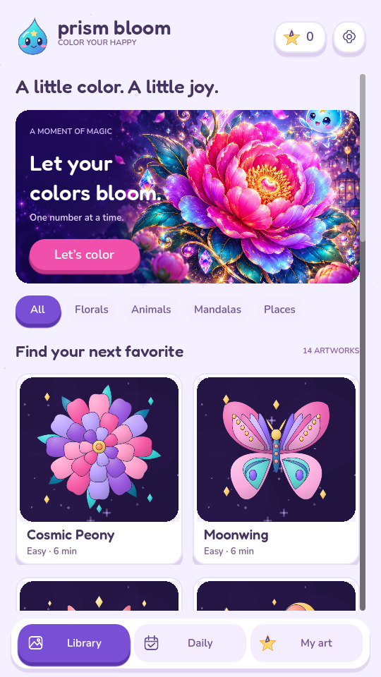

# Prism Bloom

An original, offline **Godot 4.6** color-by-number game for portrait mobile screens. Pick an illustration, match its numbers, and turn a little patience into something colorful.



## Open and play

1. Download this repository (**Code → Download ZIP**) and extract it.
2. In **Godot 4.6 or newer**, click **Import**, select `project.godot`, and let assets import.
3. Press **F5**. No plugins, Python packages, server, account, or API keys are needed to play.

Tested with **Godot 4.6.3 stable**, Compatibility renderer. Python is used only for optional artwork tools and development checks.

## Play

- Select an artwork in **Library**, or choose the rotating **Daily** selection.
- Choose a numbered color, then tap a region carrying that number. Wrong colors never fill a region.
- **Touch:** tap to color; drag to pan; pinch with two fingers to zoom.
- **Desktop:** click to color; drag to pan; scroll to zoom. The zoom and **Fit** buttons also work.
- **Find a spot** brings a matching unfinished region into view. Hints are unlimited.
- Progress saves after every fill. **My art** holds unfinished and completed work.
- Finish a picture for a replay of your coloring order, chimes, and a celebration. Three and six unique completions unlock bonus art.
- Sound and mobile haptics can be disabled in Settings. Escape / Android Back returns to the gallery.

The library includes **12 starter illustrations and two milestone artworks**, across Florals, Animals, Mandalas, and Places. Six original design families have coordinated color variations; the largest puzzle has **209 regions**. Tiny labels appear as you zoom in so intricate areas stay readable.

## What's included

- Editable `.tscn` scenes for the gallery, gameplay, reusable region, board, palette chip, artwork tile, particles, settings, and reward screen.
- Inspector-editable `ArtworkData` resources; numbered JSON geometry; original SVG source illustrations.
- Accurate polygon hit testing, anchored zoom, bounded pan, touch cancellation, and mobile safe-area handling.
- Atomic local saves, duplicate-fill protection, validation of saved IDs, and preservation of corrupt files for recovery.
- Original sprite mascot, illustrated feature banner, shaded vector previews, rounded typography, button feedback, synthesized audio, and particles.
- An Android export preset, automated tests, and real captured game screens.

## Project map

| Location | Responsibility |
|---|---|
| `scenes/main.tscn` | Screen composition and navigation signals |
| `scenes/ui/` | Gallery, cards, palette chips, settings, celebration |
| `scenes/game/` | Gameplay layout, vector board, region, fill particles |
| `scripts/game/` | Resource definition, input, hit testing, color progress |
| `autoload/` | Save state/catalog and audio voices |
| `resources/levels/` | Artwork resources and compiled region data |
| `content/svg/` | Original flat-color artist source files |
| `assets/` | Presentation artwork, icons, licensed fonts, sound |
| `tools/` | Optional content pipeline and developer checks |
| `tests/` | Importer, gameplay, persistence, geometry and visual checks |

UI layout is authored as scene nodes. Scripts instantiate only repeated, data-driven objects such as regions, artwork tiles, and palette chips. You can edit scenes directly in Godot; running the scene-generation tool is unnecessary and would overwrite scene edits.

## Tests

```bash
# Use GODOT_BIN=godot if that is your executable name.
./tools/run_checks.sh

# Real window/input checks, with a display available:
godot4 --path . tests/test_runner.tscn

# Capture the actual rendered game into docs/screenshots/:
godot4 --path . tests/capture_screens.tscn
```

Tests use separate save filenames and do not modify player progress. The headless run explicitly skips one window mouse-routing check; the same check runs with a display. The renderer and screenshots require a graphical session (or Xvfb on Linux). See [validation notes](docs/VALIDATION.md).

## Create artwork

See [the content pipeline](docs/CONTENT_PIPELINE.md). For a supported, flattened SVG with closed regions:

```bash
python3 tools/import_svg.py content/svg/my_art.svg resources/levels/my_art.json --cluster 8
```

Create an `ArtworkData` resource, assign the data path and preview texture, and add its ID to `Progress.ART_IDS`. Exact RGB matching is the default; `--cluster` merges similar colors using the supplied RGB distance threshold.

## Android

Install the **matching Godot export templates**, **OpenJDK 17**, and the Android SDK required by Godot 4.6; configure their paths in Editor Settings → Export → Android. The **Android** preset includes raw level JSON, uses arm64 and portrait orientation, and requests vibration but no Internet permission. Export a debug APK to test on a phone. Choose your own unique package name and release signing key before distribution. No signing credentials are included.

The desktop game and simulated touch gestures have been tested. Native Android/iOS builds, physical device haptics, notches, thermal performance, and store submission have not been validated here. iOS export requires macOS/Xcode and a separate export configuration.

## Scope

This is a complete playable offline first release, not a live content service. **Daily** rotates the bundled starter library according to the device's local date; it does not download fresh art and there is no paid archive. Ads, purchases, subscriptions, cloud sync, analytics, and thousands of illustrations are not implemented. There are no fake purchase or ad buttons.

The game uses original artwork and branding. It does not bundle Colorscapes artwork, characters, trademarks, or assets. [Asset credits and licenses](docs/CREDITS.md).
